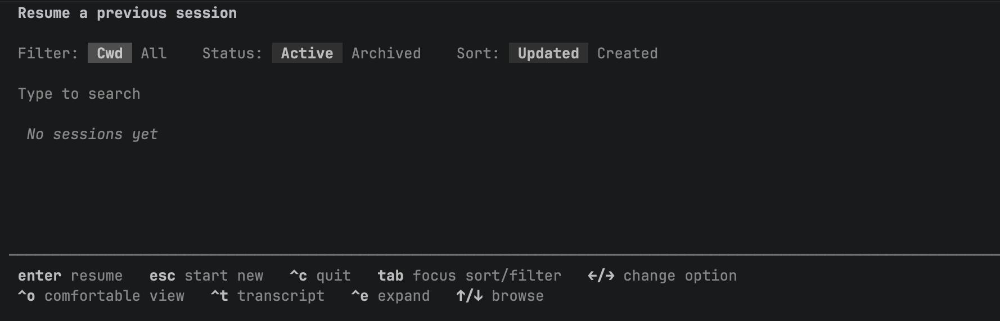
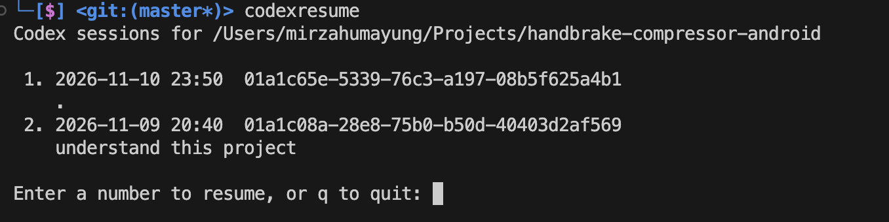

# codexresume

A small helper for resuming Codex sessions that don't appear in the latest Codex session picker.

This exists because, in some versions of Codex, previously saved sessions may not be shown when you try to resume them. Whether this is a bug or intentional behavior is unclear.

`codexresume` looks through the locally saved sessions for the current directory, shows them in a simple list, and lets you pick one to resume.

### Native codex resume return no sessions history


### ./codexresume shows them all again


## Usage

Run it from your project directory:

```bash
./codexresume
```

Or specify a directory:

```bash
./codexresume --cwd /path/to/project
```

Pick a session from the list and it will launch:

```text
codex resume ...
```

## Compressed sessions

If some sessions are stored as `.zst` files, install either:

```bash
pip install zstandard
```

or have `zstd` installed.

## Requirements

- Python 3
- `codex` available on `PATH`

The script reads the sessions stored under `CODEX_HOME` (default: `~/.codex`).